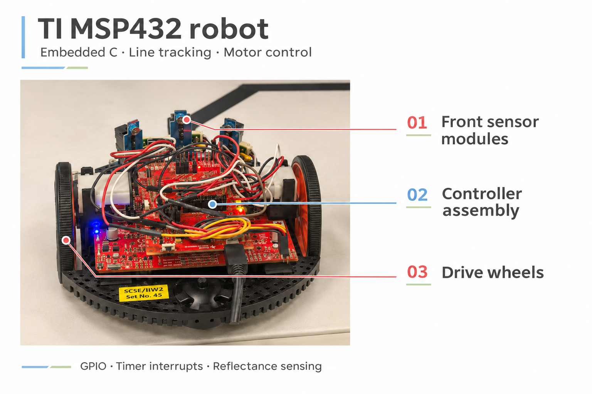

# TI MSP432 · Line-Tracking Robot

**Embedded C · GPIO · Timer PWM · Interrupts · Hardware integration**

A hands-on MSP432P401R robot project connecting reflectance sensing to differential motor control. This portfolio brings together the physical build and selected coursework firmware, with a traceable path from GPIO readings to wheel commands.

## Project at a glance

| Platform | Implementation |
|---|---|
| MCU | Texas Instruments MSP432P401R |
| Development | C, Code Composer Studio, TExaS instrumentation |
| Sensing | Eight-channel reflectance interface; two centre channels used for line tracking; six bump switches |
| Actuation | Two motor channels controlled through GPIO direction/enable and TimerA0 PWM |
| Timing | A separate sensor example uses a 1 ms SysTick interrupt and a 10 ms sampling cycle |

## What I worked on

- Integrated reflectance input with forward, left, right and stop motor commands in the lab robot application.
- Worked with register-level GPIO configuration, bit extraction and timer-driven PWM in the course framework.
- Used the physical robot and lab instrumentation to connect firmware behaviour with sensor and motor wiring.

The application and driver snapshots retain the original course framework and its copyright notices. The included framework is credited below; this project does not claim that every library was written from scratch.

## From sensor bits to movement

The line-tracking loop reads `Reflectance_Center(1000)` and selects a motor command every cycle:

| Centre-sensor result | Command in the saved application |
|---|---|
| `0b11` | `Motor_Forward(1500, 1500)` |
| `0b10` | `Motor_Left(1500, 1500)` |
| `0b01` | `Motor_Right(1500, 1500)` |
| `0b00` | `Motor_Stop()`, followed by a 1 s pause |

The foreground loop includes a 10 ms delay between readings. Motor duty values are timer counts, not calibrated vehicle speed.

**Read the implementation:** [line-tracking application](firmware/Lab3_TimerCompare_Motor/Lab3_Timersmain.c) · [reflectance interface](firmware/inc/Reflectance.c) · [motor interface](firmware/inc/Motor.c) · [PWM configuration](firmware/inc/PWM.c)

## Timing and hardware interfaces

The [sensor sampling example](firmware/Lab3_Bump_Reflectance_Systick/Lab3_Sensorsmain.c) separates the charge and read phases across SysTick interrupts. It starts a reflectance measurement at tick 0, reads the sensor and bump states at tick 1, and repeats after ten ticks.

The motor application also registers a TimerA1 callback that polls bump inputs and writes motor-enable outputs. Its interaction with foreground motor commands is documented in the [control-path review](docs/control-path.md); a reliable collision-stop result has not been established from this snapshot.

## Build evidence and engineering notes

The annotated panel uses AI-assisted layout based on the [original bench photograph](assets/originals/ti-bench.jpg). The original remains the photographic record of the hardware.

- [Control path, active pin mapping and source observations](docs/control-path.md)
- [Bench validation procedure and evidence boundaries](docs/bench-validation.md)
- [Source selection, dependencies and reproduction scope](firmware/README.md)

The files here are selected historical source snapshots for review. They are not a complete, recently validated CCS build. No quantitative speed, tracking accuracy or repeatability result is claimed.

## Attribution

Developed in an SC2107 coursework context using the MSP432/RSLK teaching framework associated with Jonathan Valvano's embedded-systems materials. Original source headers and the Simplified BSD terms are preserved.
